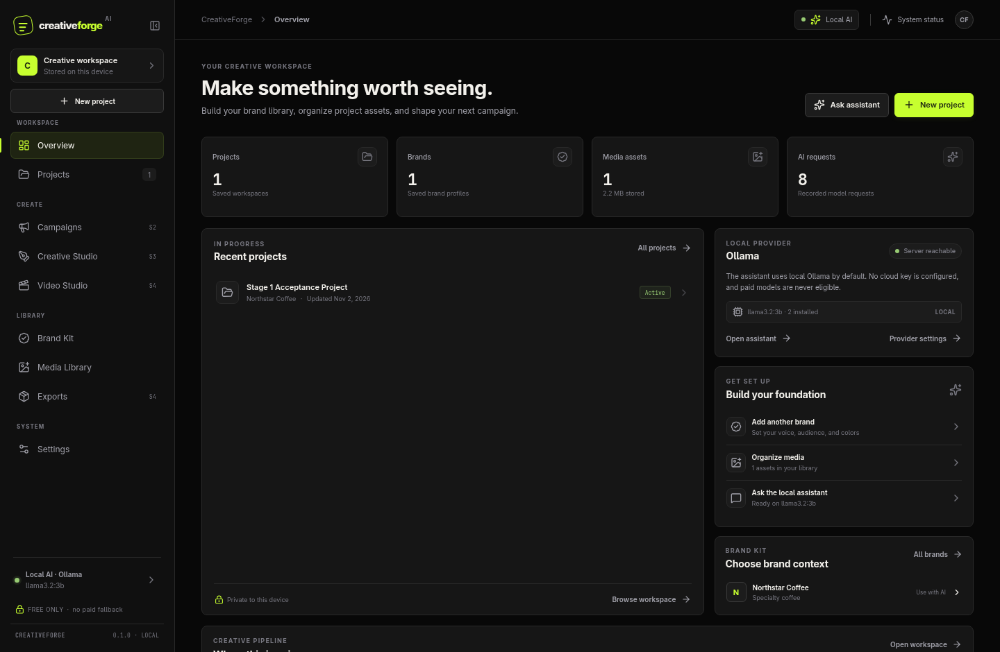
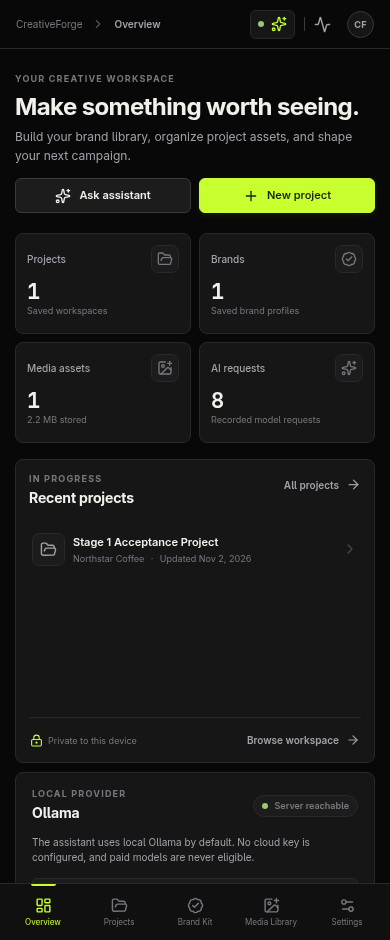
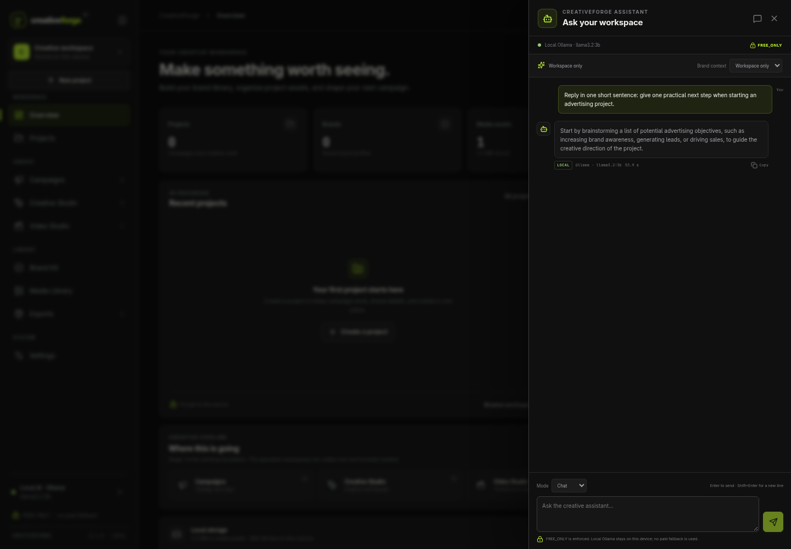
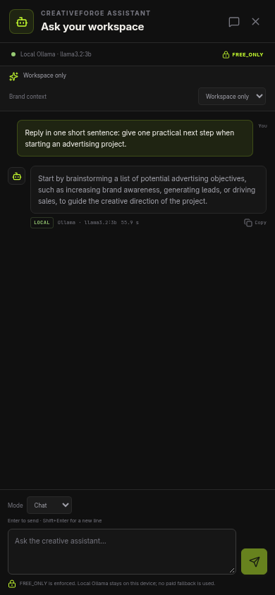
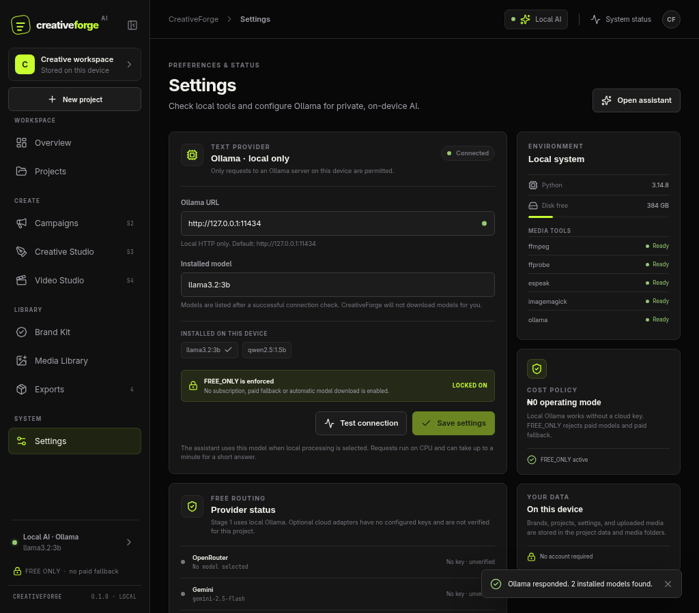
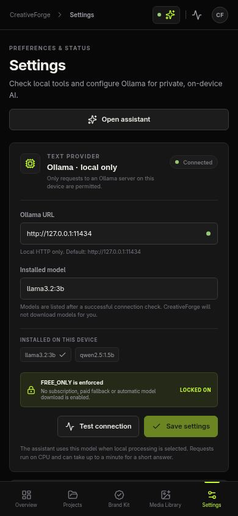

# CreativeForge AI

CreativeForge AI is a local-first advertising and creative-production workspace. Stage 1 provides a
real project and brand workspace, local media library, device settings, and a contextual AI assistant
that sends prompts to an installed Ollama model. The core app runs without a cloud account, cloud key,
payment method, or hosted service. The project maintains a strict **₦0 / FREE_ONLY** policy.

## Stage 1 features

- Responsive Overview, Projects, Brand Kit, Media Library, and Settings workspaces.
- Upcoming Campaigns, Creative Studio, Video Studio, and Exports destinations are explicitly marked
  as not implemented.
- SQLite project and brand create, read, update, and delete operations.
- Local media import and preview with generated filenames, type/signature validation, and preservation
  of originals.
- Ollama connection check (server and installed models), real local chat with project/brand context,
  and installed-model detection.
- Chat shows its provider, model, local/cloud status, loading state, errors, retry, and success output.
- Local system/tool status and an enforced FREE_ONLY setting.
- Dark and light appearance preferences.

Campaign authoring, graphic composition, video editing/rendering, voice, subtitles, and exports are
future stages. A route or placeholder for one of those workspaces does not mean the feature is complete.

## Stage 1 preview

These are Chromium screenshots of the running application at the sizes shown:

| Workspace | Desktop/laptop | Mobile |
| --- | --- | --- |
| Overview |  |  |
| AI assistant |  |  |
| Settings |  |  |

## Requirements

- Python 3.14 and the packages pinned in `backend/requirements.txt`.
- Node.js and npm, with dependencies from `frontend/package.json`.
- Ollama for AI chat. CreativeForge checks installed models but does not download any.
- Optional local tools: FFmpeg/FFprobe, ImageMagick, and eSpeak NG. Their presence is reported in
  Settings; they are not required to open the Stage 1 workspace.

The audited computer has Node 26.8.2, npm 12.2.0, Python 3.14.8, FFmpeg/FFprobe 9.0.2, ImageMagick
7.1.2, and eSpeak NG 1.52. Ollama is reachable at `127.0.0.1:11434`; the audit found `llama3.2:3b`
and `qwen2.5:1.5b` installed. The laptop has 7.6 GiB RAM, a 2-core/4-thread Intel i5-2540M and legacy
integrated graphics. These small models are CPU workloads; available swap is not physical memory.
Recheck the Ollama model list before relying on it. No models or packages were downloaded for this
handoff.

## Setup on another machine

The project does not install dependencies automatically at startup. If the local environments are
missing, install only the declared open-source packages explicitly:

```bash
python3 -m venv backend/.venv
backend/.venv/bin/pip install -r backend/requirements.txt
npm --prefix frontend install
```

These commands may access package registries. They do not enable billing or install AI models. On the
audited machine, the virtual environment and frontend dependencies already exist.

## Start CreativeForge AI

From the repository root:

```bash
./scripts/start.sh
```

Open <http://127.0.0.1:5173>. The API is bound to <http://127.0.0.1:8787>; Vite proxies `/api` to it.
Press Ctrl+C in the terminal to stop the processes started by the script. If a healthy API is already
running, the script reuses it and leaves that separately started process running.

To start either service separately, use `./scripts/dev-backend.sh` and
`./scripts/dev-frontend.sh` in separate terminals.

## Local data and configuration

- SQLite database: `data/creativeforge.db`
- Backend-only optional secrets: `data/secrets.json`
- Uploaded originals: `media/uploads/`
- Project files and temporary work: `media/projects/`
- Previews: `media/previews/`
- Voice output: `media/voice/`
- Exports: `media/exports/`
- Ollama default: `http://127.0.0.1:11434`

The browser never reads SQLite, secret files, or the media directory directly. CreativeForge binds to
localhost and serves validated media by ID. Do not expose the local API to a public network.

Ollama URL configuration is restricted to local HTTP hosts. `FREE_ONLY` cannot be disabled. Selecting
Ollama uses only local Ollama and does not fall through to cloud providers. Optional cloud adapter code
is not verified or accepted as an operational Stage 1 path; no cloud credentials are configured or
required.

## Verification

```bash
./scripts/test-backend.sh
npm --prefix frontend run typecheck
npm --prefix frontend run build
```

Backend tests use an isolated temporary SQLite workspace. They do not clear or replace the local
application database. Live acceptance also checks CRUD through the running API, a real local Ollama
response, and the interface at 1440, 1280, 1024, and 390 pixels.

Current Stage 1 result (2026-11-02):

- **14 backend tests pass**, including remote Ollama URL rejection and a connection check that never
  generates text.
- TypeScript typecheck and the production build pass.
- `./scripts/start.sh`, `./scripts/dev-backend.sh` and `./scripts/dev-frontend.sh` were verified from a
  clean stop.
- Project and brand CRUD persisted in SQLite, survived a reload, and the acceptance records were
  deleted afterward.
- A real image was uploaded through the Media Library, previewed from its validated media URL, and
  removed through the API; the existing library asset was preserved.
- Ollama detected `llama3.2:3b` and `qwen2.5:1.5b`; the connection check completed in under a second
  without loading a model.
- Real local chat returned `UI_OK` from `llama3.2:3b` with project and brand context. CPU response time
  ranged from 4.3 seconds warm to 135.7 seconds cold during acceptance.
- The failure state showed an actionable local-provider error with no paid fallback. Console errors,
  uncaught exceptions and failed network requests were zero; the intentional failure test produced one
  expected HTTP 502.
- No horizontal overflow was found at 1440, 1280, 1024 or 390 pixels.

Cloud adapters remain **unverified**. They are not required for Stage 1, and no cloud key, billing,
trial, paid fallback or automatic model download is used. The Settings connection check only inspects
the local Ollama server and installed models; inference is exercised when you send a message.

## Troubleshooting

- **The local API does not start:** run `./scripts/start.sh` from this directory and read the terminal
  error. The script reports missing dependencies without installing them.
- **Ollama is unavailable:** start the local Ollama service, then open Settings and test the connection.
  CreativeForge lists only already-installed models and never runs `ollama pull`.
- **A selected model is missing:** choose one of the models shown in Settings. No automatic download
  is offered.
- **An upload is rejected:** use a supported image, video, or audio type under the configured per-type
  size limit. The original file is preserved.
- **A media tool is missing:** check its status in Settings. CreativeForge does not install operating
  system packages automatically.
- **A backend test emits an HTTPX deprecation warning:** the test client currently reports a Starlette
  compatibility warning; the Stage 1 test suite still passes.

## Project instructions

Read `AGENTS.md`, `docs/PROJECT_SPEC.md`, `docs/UI_UX_SPEC.md`, `docs/API_CONTRACT.md`, and
`docs/COORDINATION.md` before making changes. `docs/FEATURE_STATUS.md` and
`docs/FREE_PROVIDER_POLICY.md` record what is implemented and what remains unverified.
